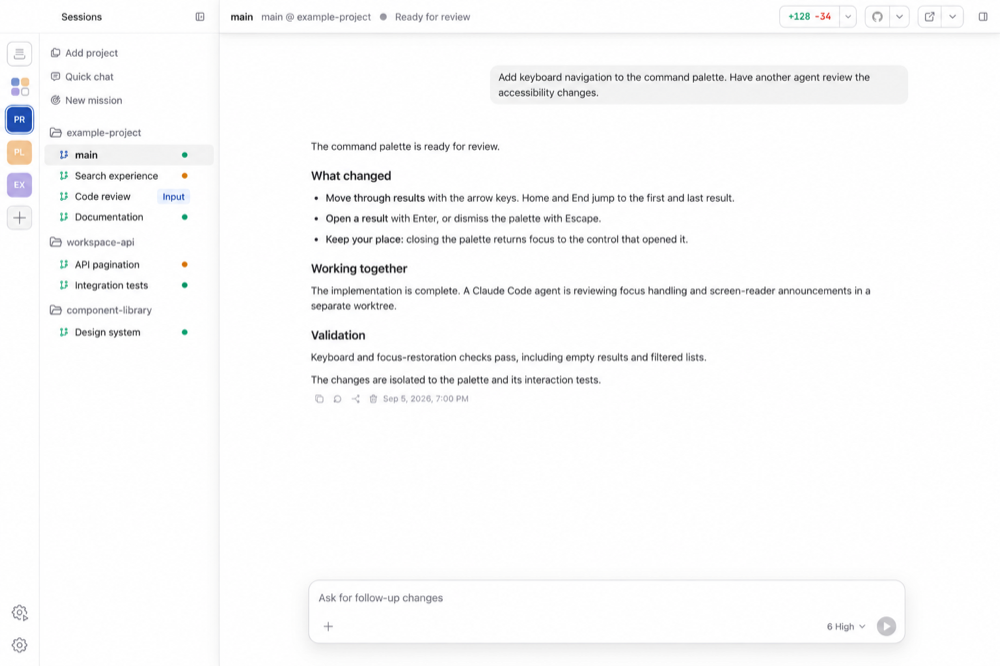
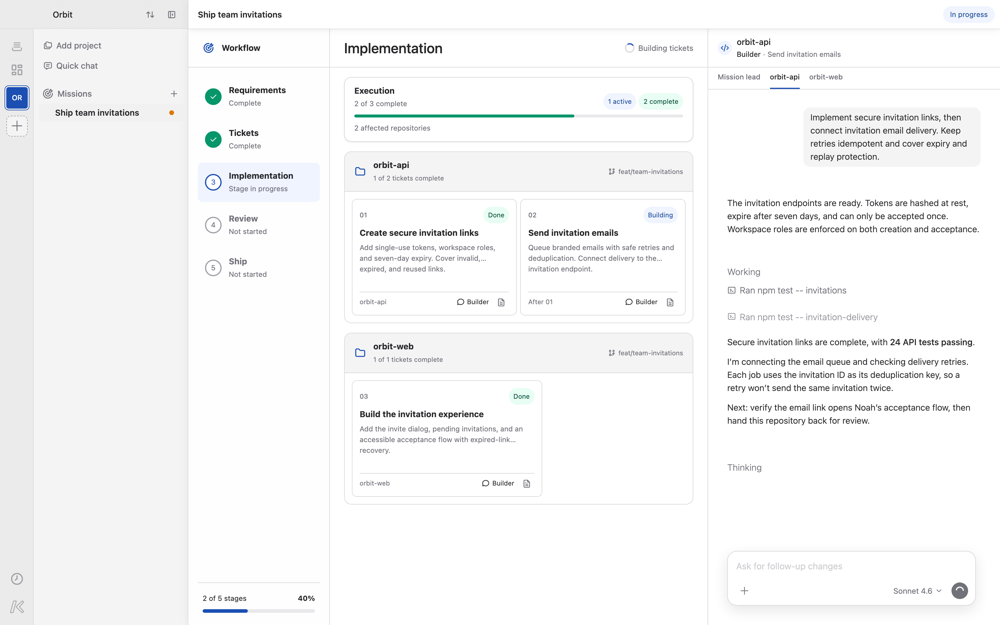
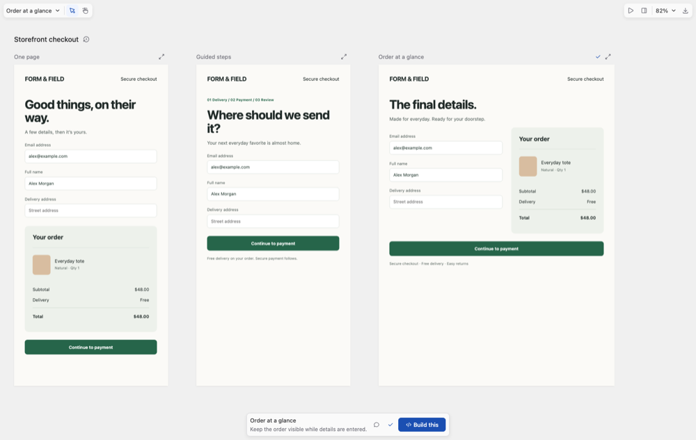

<h1 align="center">Korus</h1>

  <strong>Build with agents. From idea to delivery.</strong> 
  A team of coding agents, across repositories and machines.

  <a href="https://meetkorus.dev"><strong>Get Korus</strong></a>

  
  
  

Korus brings Codex, Claude, Cursor, and Antigravity into one workspace. Run one agent on its own, or a mixed team with a conversation for each.

## Build your own

The engines and interface behind Korus are open source. Use the layer you need.

- **[Agent UI SDK](https://github.com/Korus-Dev/agent-ui-sdk)**: Vue conversation controls and Electron adapters for agent apps. [npm](https://www.npmjs.com/package/@korus-dev/agent-ui-sdk) · [Docs](https://korus-dev.github.io/agent-ui-sdk/)
- **[Multi Agent SDK](https://github.com/Korus-Dev/multi-agent-sdk)**: One Node.js API for Codex, Claude, Cursor, and Antigravity. [npm](https://www.npmjs.com/package/@korus-dev/multi-agent-sdk) · [Docs](https://korus-dev.github.io/multi-agent-sdk/)
- **[Codex SDK](https://github.com/Korus-Dev/codex-sdk)**: A typed client for the Codex app-server. [npm](https://www.npmjs.com/package/@korus-dev/codex-sdk) · [Docs](https://korus-dev.github.io/codex-sdk/)

All projects are Apache-2.0 licensed and maintained independently of the providers they connect to.
